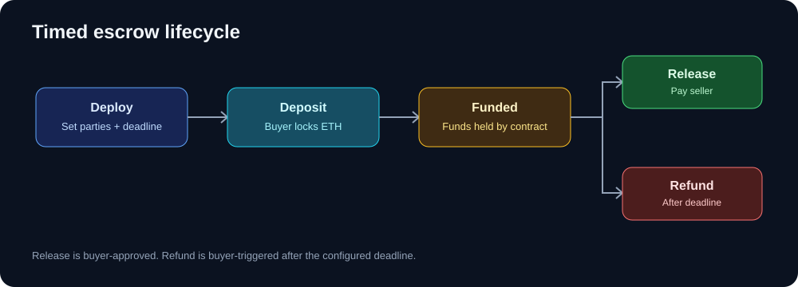
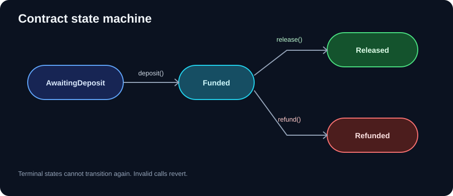
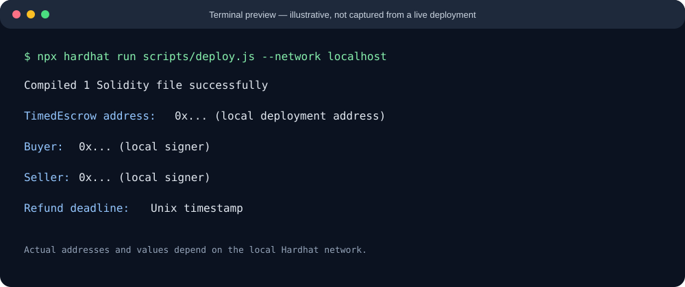

# Timed Escrow Smart Contract

A state-driven Ethereum escrow example built with **Solidity 0.8.28**, Hardhat, and Ethers v6. The buyer deposits ETH, then either approves payment to the seller or reclaims the deposit after a configured deadline

  

> **Scope:** This repository is an educational reference implementation. It has not been audited and should not hold production funds without independent review

## At a glance

- One contract instance represents one transaction
- Buyer and seller are fixed when the contract is deployed
- ETH can be deposited once, and the amount is tracked on-chain
- The buyer may release the payment at any time while funded
- After the deadline, the buyer may trigger a refund
- Events expose deposits, releases, and refunds to indexers and user interfaces

## Transaction lifecycle



The contract does not verify off-chain delivery or arbitrate disputes. The buyer decides whether to release the payment; the deadline provides a refund path if the payment remains funded

## State model



| State | Meaning | Allowed transition |
|---|---|---|
| `AwaitingDeposit` | No payment has been deposited | `deposit()` → `Funded` |
| `Funded` | ETH is held by the contract | `release()` → `Released`; `refund()` → `Refunded` after deadline |
| `Released` | Payment was sent to the seller | Terminal |
| `Refunded` | Payment was returned to the buyer | Terminal |

## Contract interface

The main implementation is [`contracts/TimedEscrow.sol`](contracts/TimedEscrow.sol).

### Constructor

```solidity
constructor(address sellerAddress, uint256 refundWindow)
```

The deployer becomes `buyer`. The seller address must be non-zero and different from the buyer, and the refund window must be positive. The deadline is stored as an immutable timestamp

### Main functions

```solidity
function deposit() external payable;
function release() external;
function refund() external;
```

- `deposit()` accepts a single non-zero ETH deposit from the buyer
- `release()` sends the tracked amount to the seller after the buyer approves it
- `refund()` returns the tracked amount to the buyer once `block.timestamp >= refundDeadline`

Access checks and state checks use custom errors. State is updated and the tracked balance is cleared before the external value transfer; if the transfer fails, the transaction reverts atomically

### Events

| Event | When emitted |
|---|---|
| `Deposited` | Buyer deposits ETH |
| `PaymentReleased` | Escrow payment reaches the seller |
| `Refunded` | Escrow payment returns to the buyer |

## Run locally

### Requirements

- Node.js 18 or newer
- npm

### Install and compile

```bash
npm install
npm run compile
```

### Start a local chain

In terminal one:

```bash
npx hardhat node
```

In terminal two, from the project directory:

```bash
npm run deploy:local
```

The deployment script uses two local Hardhat signers as the buyer and seller. No personal wallet address or private key is embedded in the source



*Illustration only; it is not a screenshot of a real run. Capture your own terminal output after running the commands if you want to publish an environment-specific screenshot*

## Example interaction

This snippet assumes a local Hardhat test or script context:

```javascript
const { ethers } = require("hardhat");

const [buyer, seller] = await ethers.getSigners();
const Factory = await ethers.getContractFactory("TimedEscrow");
const escrow = await Factory.deploy(seller.address, 3600);
await escrow.waitForDeployment();

await escrow.connect(buyer).deposit({
  value: ethers.parseEther("0.1"),
});

// Buyer approves the transfer to the seller.
await escrow.connect(buyer).release();
```

To test the refund route, deploy with a short window, deposit ETH, advance local EVM time past `refundDeadline`, and call `refund()` from the buyer signer

## Tests

```bash
npm test
```

The test suite covers initialization, deposit and release, access control, and deadline-based refunds

## Security notes

- **No dispute resolution:** the contract cannot judge whether a product or service was delivered
- **Buyer-controlled release:** the seller cannot force release through this interface
- **Refund is not automatic:** someone must call `refund()` after the deadline; the buyer is the only authorized caller
- **Recipient compatibility:** release/refund can revert if the recipient cannot receive ETH
- **One deposit per instance:** create a new instance for each separate transaction
- **Review before production:** add independent audit coverage, deployment controls, monitoring, and threat modelling before handling real funds

## Repository layout

```text
.
├── contracts/
│   └── TimedEscrow.sol
├── docs/
│   └── images/
│       ├── deployment-preview.svg
│       ├── escrow-lifecycle.svg
│       └── state-machine.svg
├── scripts/
│   └── deploy.js
├── test/
│   └── timed-escrow.test.js
├── hardhat.config.js
├── package.json
└── README.md
```